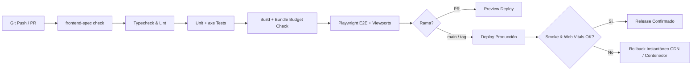

# Blueprint: Estrategia de Build, Despliegue y CI/CD Frontend

## 1. Pipeline CI/CD Estándar (Mermaid)

---

## 2. Variables de Entorno Públicas (Sin Secretos)

| Variable | Prefijo del Stack | Descripción | Secreto? |
| :--- | :--- | :--- | :--- |
| `*_API_BASE_URL` | `VITE_` / `NEXT_PUBLIC_` / `PUBLIC_` | URL pública del API gateway | No |
| `*_APP_ENV` | `VITE_` / `NEXT_PUBLIC_` / `PUBLIC_` | Entorno (`development` / `staging` / `production`) | No |

> **Regla de Seguridad Crítica:** Cualquier variable empaquetada en cliente es pública por definición. Nunca colocar claves privadas API, secrets OAuth ni llaves de firma en variables de build del frontend.

---

## 3. Cabeceras de Seguridad, Caché y Rollout
- **Caché Inmutable:** Assets con hash (`/assets/*`, `/_next/static/*`) servidos con `Cache-Control: public, max-age=31536000, immutable`; documento raíz (`index.html`) con `Cache-Control: no-cache, must-revalidate` para evitar clientes atrapados en versiones obsoletas tras un despliegue.
- **Cabeceras de Seguridad HTTP:** `Content-Security-Policy`, `X-Content-Type-Options: nosniff`, `Referrer-Policy: strict-origin-when-cross-origin`, `X-Frame-Options: DENY` (o `frame-ancestors`).
- **Estrategia de Rollout / Rollback:** Despliegue atómico (CDN o Rolling/Blue-Green en SSR) con rollback inmediato si aumentan errores 5xx/chunks faltantes (`ChunkLoadError`) o degradan Web Vitals en el primer tramo de tráfico.

---

## Historial de Revisiones (Últimos Cambios)

| Versión | Fecha | Requerimiento | Resumen del Cambio |
| :--- | :--- | :--- | :--- |
| `v0.1.0` | YYYY-MM-DD | `INIT` | Plantilla base de despliegue, caché, seguridad y CI/CD frontend. |

> *Nota: Esta tabla mantiene una ventana deslizante de los últimos 3 cambios. Para el historial completo, consultar `docs/backlog/changelog.md`.*
