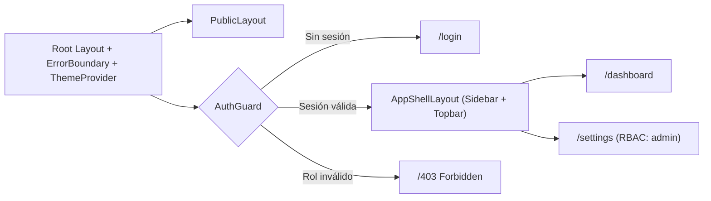

# Blueprint: Arquitectura de Rutas, Layouts y Renderizado

## 1. Mapa de Rutas y Estrategia de Renderizado

| Patrón de Ruta | Flujo UX (`UF-*`) | Layout Padre | Modo de Renderizado | Guardia (`Auth / RBAC`) | Error Boundary / Fallback |
| :--- | :--- | :--- | :--- | :--- | :--- |
| `/` | `UF-CORE-001` | `PublicLayout` | `SSG` / `SSR` | Público | `GlobalErrorBoundary` |
| `/login` | `UF-AUTH-001` | `AuthLayout` | `CSR` / `SSR` | Solo invitados (redirige si autenticado) | Mensaje inline |
| `/dashboard` | `UF-DASH-001` | `AppShellLayout` | `CSR` / `SSR` | Autenticado (`session != null`) | `DashboardErrorBoundary` + `403` |
| `*` | - | `PublicLayout` | Estático | Público | Vista `404 Not Found` |

---

## 2. Diagrama de Navegación y Layouts (Mermaid)

---

## 3. Reglas de Seguridad en Rutas, Hidratación y SEO

- **Cero Parpadeo Privado (`NoPrivilegedFlash`):** Mientras se resuelve la sesión o el guardia de ruta, renderizar únicamente indicador de espera neutro; nunca exponer JSX/HTML protegido antes de redirigir.
- **Preservación de Destino:** Al redirigir a `/login`, conservar ruta de retorno validada contra rutas internas relativas (`returnTo` sanitizado para evitar Open Redirect).
- **SEO y Metadatos (Rutas Públicas):** Toda ruta pública declara `<title>`, `<meta name="description">`, etiquetas OpenGraph y URL canónica mediante la API nativa del meta-framework (`Metadata` en Next.js, `useSeoMeta` en Nuxt, `<svelte:head>`, `Title`/`Meta` en Angular).

---

## Historial de Revisiones (Últimos Cambios)

| Versión | Fecha | Requerimiento | Resumen del Cambio |
| :--- | :--- | :--- | :--- |
| `v0.1.0` | YYYY-MM-DD | `INIT` | Plantilla base de rutas, guardias y estrategia de renderizado. |

> *Nota: Esta tabla mantiene una ventana deslizante de los últimos 3 cambios. Para el historial completo, consultar `docs/backlog/changelog.md`.*
