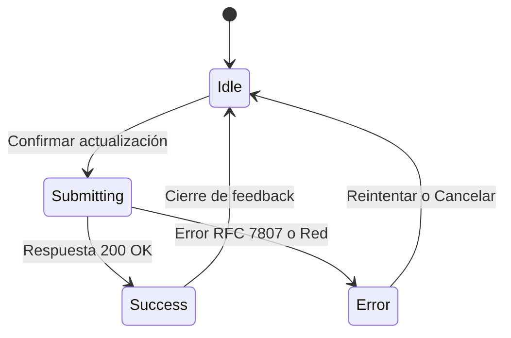

# CMP-[DOMINIO]-[NUM]: [NombreComponente]

## 1. Contrato Agnóstico de Props / Inputs y Eventos

```typescript
export interface ComponentContractProps {
  userId: string;
  fullName: string;
  avatarUrl?: string;
  role: "admin" | "editor" | "viewer";
  isLoading?: boolean;
  onUpdateRole?: (newRole: "admin" | "editor" | "viewer") => Promise<void>;
}
```

### Adaptación por Ecosistema:
- **React / Next.js:** Props tipadas en `ComponentContractProps` + callbacks `on*`.
- **Vue / Nuxt:** `defineProps<Omit<ComponentContractProps, "onUpdateRole">>()` + `defineEmits<{ updateRole: [newRole: string] }>()`.
- **Svelte / SvelteKit:** `$props()` tipado con `ComponentContractProps`.
- **Angular:** Signals `input.required<string>()` / `input<...>()` + `output<string>()`.

---

## 2. Slots / Composición Estructural
- **`header` (o `HeaderSlot`):** Badge de rol, avatar y título identificable.
- **`actions` (o `ActionSlot`):** Controles primarios/secundarios con confirmación si es destructivo.
- **`empty` / `fallback`:** Contenido mostrado ante ausencia de datos opcionales.

---

## 3. Máquina de Estados Finita (FSM)



### Invariantes de Estado:
- Prohibido pasar de `Submitting` de nuevo a `Submitting` (evita doble petición).
- En `Error`, conservar la selección del usuario hasta confirmación exitosa o cancelación explícita.

---

## 4. Contrato de Accesibilidad y Teclado

| Elemento / Región | Rol / Atributo ARIA | Comportamiento de Teclado |
| :--- | :--- | :--- |
| Botón primario | `role="button"`, `aria-busy` | Activable con `Enter` y `Space`; foco visible obligatorio |
| Mensaje de estado/error | `role="alert"` o `aria-live="polite"` | Anunciado sin robar foco salvo error bloqueante |

---

## Historial de Revisiones (Últimos Cambios)

| Versión | Fecha | Requerimiento | Resumen del Cambio |
| :--- | :--- | :--- | :--- |
| `v0.1.0` | YYYY-MM-DD | `REQ-UI-[DOMINIO]-001` | Definición inicial del componente. |

> *Nota: Esta tabla mantiene una ventana deslizante de los últimos 3 cambios. Para el historial completo, consultar `docs/backlog/changelog.md`.*
