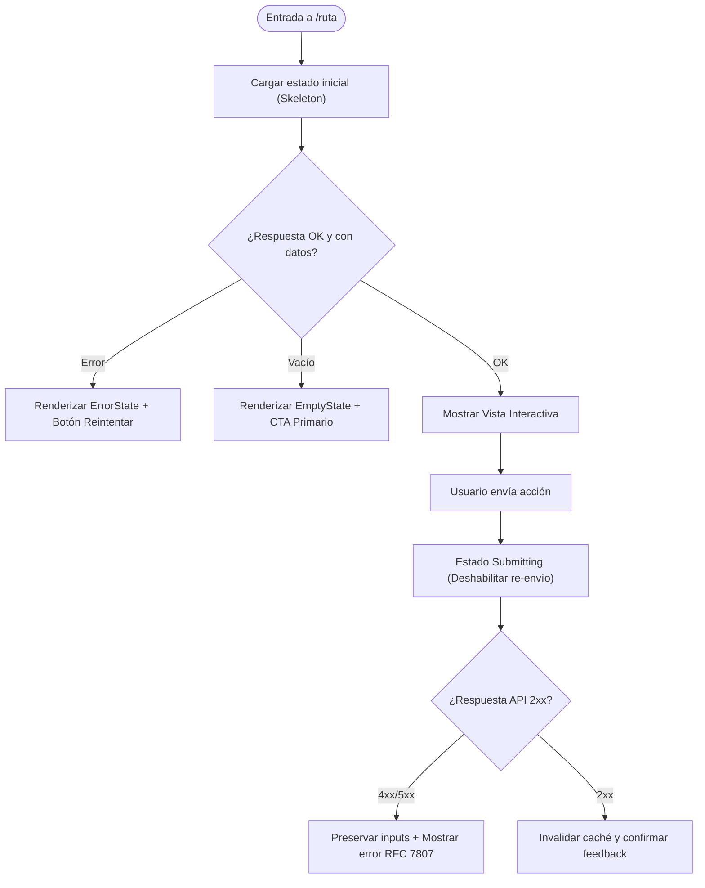

# UF-[DOMINIO]-[NUM]: [Nombre del Flujo de Usuario]

## 1. Contexto, Ruta y Precondiciones
- **Dominio:** `[dominio]`
- **Actor Principal:** `[Usuario Final | Administrador | Invitado]`
- **Ruta de Entrada:** `GET /[ruta-ejemplo]` (o modal/drawer disparado desde `[origen]`)
- **Disparador (Trigger):** `[Acción inicial del usuario o carga inicial de vista]`
- **Precondiciones:**
  - Sesiones/permisos requeridos (ej. rol `editor` verificado por *Route Guard*).
  - Datos previos o contratos API disponibles (`api-contracts.md` / mocks MSW).

---

## 2. Diagrama del Flujo de Interacción (Mermaid)


---

## 3. Entradas de Usuario y Salidas Visuales
*(Agnóstico de framework: válido para React, Next.js, Vue, Nuxt, SvelteKit, Astro o Angular)*

### Eventos / Entradas del Usuario:
| Acción / Campo | Tipo | Obligatorio | Validación Cliente y Feedback |
| :--- | :--- | :--- | :--- |
| `email` | String (Email) | Sí | Formato RFC 5322, mensaje inline al perder foco (`onBlur`) |
| `submitAction` | Evento Click/Enter | Sí | Bloqueado mientras `state === Submitting` |

### Salidas Visuales y Efectos:
| Elemento / Canal | Condición | Comportamiento Esperado |
| :--- | :--- | :--- |
| `Toast / Banner` | `200 / 201 OK` | Confirmación directa en región accesible `aria-live="polite"` |
| `Inline Error` | `400 / 422` | Asignado al campo exacto con `aria-invalid="true"` y `aria-describedby` |
| `Navegación` | Éxito confirmado | Redirección a `/dashboard` o actualización optimista sin recarga |

---

## 4. Matriz de Estados de Interfaz y Casos Borde

| Estado UI | Condición de Disparo | Qué ve el usuario | Acción / Recuperación |
| :--- | :--- | :--- | :--- |
| **Loading** | Carga inicial o navegación diferida | Skeleton proporcional al layout real (sin CLS) | N/A |
| **Empty** | Lista con `0` elementos | Mensaje claro + CTA único para crear primer ítem | Botón primario visible |
| **Error de Red / 5xx** | Fallo de transporte o timeout | Banner de error legible sin perder datos escritos | Botón "Reintentar" |
| **Error de Permiso / 403** | Rol insuficiente | Vista controlada `403` sin fuga de datos previos | Enlace de retorno seguro |

---

## 5. Invariantes de UI / FSM (Si aplica por `ui-contracts-guidelines.md`)

```ocl-ui
context UF_[DOMINIO]_[NUM]
inv NoDoubleSubmit:
    self.state = UIState::Submitting implies self.submitButton.disabled = true
inv PreserveInputOnTransientError:
    self.state = UIState::NetworkError implies self.formValues = self.formValues@pre
```

---

## 6. Accesibilidad (WCAG 2.1 AA) y Responsive
- **Foco Inicial y Teclado:** Al abrir la vista/modal, el foco recae en `[selector/heading]`; `Escape` cierra capas superpuestas y devuelve el foco al disparador.
- **Roles Semánticos:** Uso estricto de `<main>`, `<nav>`, `<button type="submit">` y `aria-busy="true"` durante carga.
- **Responsive:** En móvil (`< 640px`), tablas pasan a cards apiladas o scroll contenido sin `overflow-x` global.

---

## Historial de Revisiones (Últimos Cambios)

| Versión | Fecha | Requerimiento | Resumen del Cambio |
| :--- | :--- | :--- | :--- |
| `v0.1.0` | YYYY-MM-DD | `REQ-UI-[DOMINIO]-001` | Creación inicial del flujo de usuario. |

> *Nota: Esta tabla mantiene una ventana deslizante de los últimos 3 cambios. Para el historial completo, consultar `docs/backlog/changelog.md`.*
