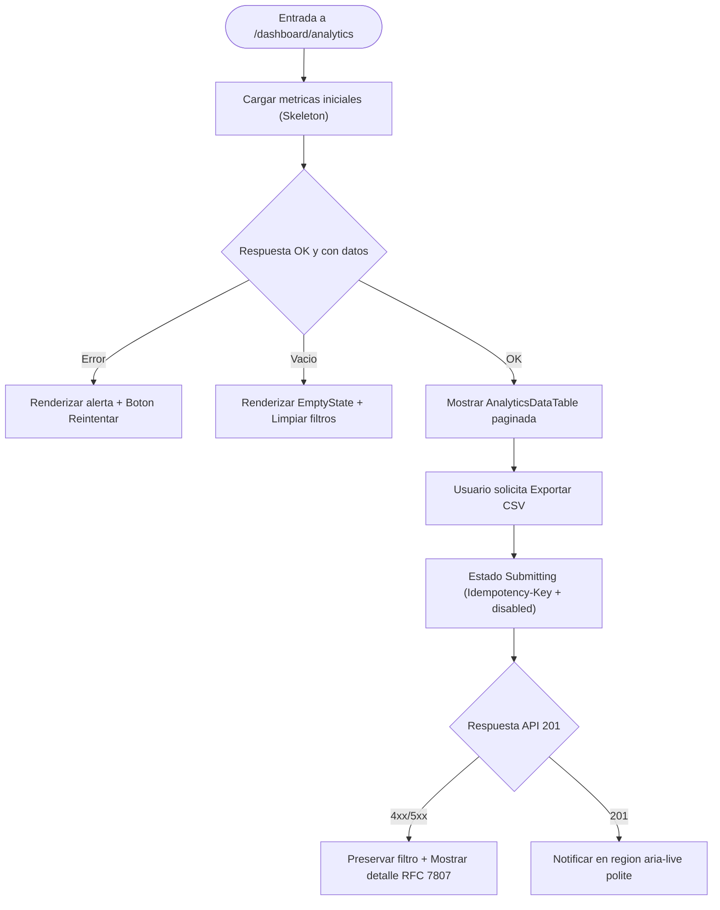

# UF-DASH-001: Consulta paginada y exportacion de analitica operativa

## 1. Contexto, Ruta y Precondiciones
- **Dominio:** `analytics`
- **Actor Principal:** `Operador Autenticado`
- **Ruta de Entrada:** `GET /dashboard/analytics`
- **Disparador (Trigger):** Carga de vista analitica o interaccion con filtros/exportacion.
- **Precondiciones:**
  - Sesion activa con rol `analyst` o `admin` verificada por el Route Guard.
  - Endpoints `/api/v1/analytics/metrics` y `/api/v1/analytics/exports` disponibles (o mocks MSW activos).

---

## 2. Diagrama del Flujo de Interaccion (Mermaid)


---

## 3. Entradas de Usuario y Salidas Visuales

### Eventos / Entradas del Usuario:
| Accion / Campo | Tipo | Obligatorio | Validacion Cliente y Feedback |
| :--- | :--- | :--- | :--- |
| `search` | String | No | Filtrado reactivo en cliente y reinicio de pagina a `1` |
| `exportAction` | Evento Click | Si | Bloqueado mientras `isSubmitting === true`, envia `Idempotency-Key` |

### Salidas Visuales y Efectos:
| Elemento / Canal | Condicion | Comportamiento Esperado |
| :--- | :--- | :--- |
| `Banner de Estado` | `201 Created` | Confirma ID de exportacion en `role="status"` (`aria-live="polite"`) |
| `Alerta de Error` | `422 / 500` | Muestra `detail` RFC 7807 sin borrar el filtro de busqueda |

---

## 4. Matriz de Estados de Interfaz y Casos Borde

| Estado UI | Condicion de Disparo | Que ve el usuario | Accion / Recuperacion |
| :--- | :--- | :--- | :--- |
| **Loading** | Carga inicial | Skeleton proporcional sin salto CLS | N/A |
| **Empty** | Filtro sin coincidencias | Mensaje claro con boton Limpiar filtros | Boton visible y enfocable |
| **Error 5xx** | Fallo temporal de red | Alerta `role="alert"` manteniendo filtro | Boton Reintentar |
| **Submitting** | Exportacion en curso | Boton `Exportando...` deshabilitado (`aria-busy="true"`) | Esperar respuesta HTTP |

---

## 5. Invariantes de UI / FSM

```ocl-ui
context UF_DASH_001
inv NoDoubleExport:
    self.state = UIState::Submitting implies self.exportButton.disabled = true
inv PreserveFilterOnError:
    self.state = UIState::Error implies self.searchFilter = self.searchFilter@pre
```

---

## 6. Accesibilidad (WCAG 2.1 AA) y Responsive
- **Foco Inicial y Teclado:** Foco natural en campo `Filtrar por endpoint`; paginacion y exportacion operables con `Tab` y `Enter`/`Space`.
- **Roles Semánticos:** Uso estricto de `<main>`, `<header>`, `<table>` con `<th scope="col">`, `<nav aria-label="Paginacion">`, `role="status"` y `role="alert"`.
- **Responsive:** Contenedor `overflow-x-auto` interno en la tabla para evitar desbordamiento horizontal en `390px`, `768px` y `1440px`.

---

## Historial de Revisiones (Últimos Cambios)

| Versión | Fecha | Requerimiento | Resumen del Cambio |
| :--- | :--- | :--- | :--- |
| `v1.1.0` | 2026-11-14 | `REQ-UI-DASH-001` | Flujo inicial de analitica operativa y exportacion idempotente. |

> *Nota: Esta tabla mantiene una ventana deslizante de los últimos 3 cambios. Para el historial completo, consultar [`docs/backlog/changelog.md`](../../backlog/changelog.md).*
