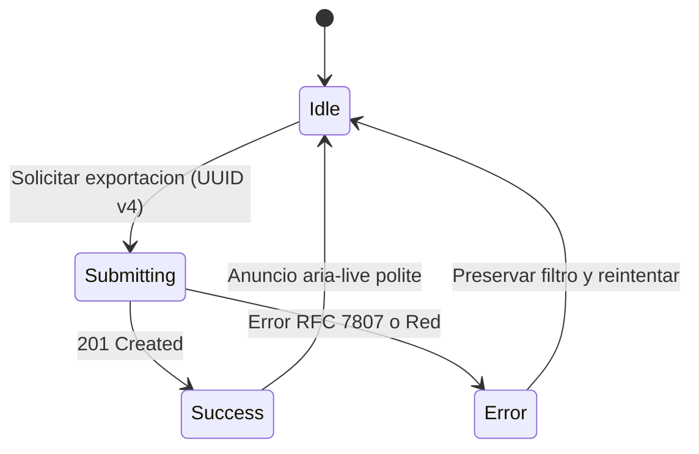

# Jerarquía y Arquitectura de Componentes — sample-dashboard-ui

## 1. Niveles de Composición (Atomic Design)
1. **Átomos (`atoms/`):** Primitivas puras sin acceso a red ni stores globales (`Button`, `Input`, `Spinner`).
2. **Moléculas (`molecules/`):** Combinación funcional acotada con estado local de interacción (`ExportReportButton`).
3. **Organismos (`organisms/`):** Secciones con lógica de dominio UI, máquinas de estado FSM y consumo de hooks (`AnalyticsDataTable`).
4. **Plantillas y Vistas (`layouts/` y `pages/`):** Composición conectada a rutas y estado remoto (`AnalyticsDashboardPage`).

---

## 2. Catálogo de Componentes Documentados

<!-- SYNC:COMPONENT_CATALOG:START -->
| ID | Componente | Nivel | Ruta | FSM | Tokens Consumidos |
| :--- | :--- | :--- | :--- | :--- | :--- |
| `CMP-DASH-001` | `AnalyticsDataTable` | `organism` | `src/features/analytics/AnalyticsDataTable.tsx` | Si | `color-surface`, `color-border`, `color-primary`, `color-danger` |
| `CMP-DASH-002` | `ExportReportButton` | `molecule` | `src/features/analytics/ExportReportButton.tsx` | Si | `color-primary` |
<!-- SYNC:COMPONENT_CATALOG:END -->

### Máquina de Estados Finita (`CMP-DASH-002` — Exportacion Idempotente)

---

## Historial de Revisiones (Últimos Cambios)

| Versión | Fecha | Requerimiento | Resumen del Cambio |
| :--- | :--- | :--- | :--- |
| `v1.0.0` | 2026-11-14 | `INIT` | Definición de niveles atómicos, regla de dependencias y catálogo base. |
| `v1.1.0` | 2026-11-14 | `REQ-UI-DASH-001` | Registro de `CMP-DASH-001` (`AnalyticsDataTable`) y `CMP-DASH-002` (`ExportReportButton`). |

> *Nota: Esta tabla mantiene una ventana deslizante de los últimos 3 cambios. Para el historial completo, consultar [`docs/backlog/changelog.md`](../backlog/changelog.md).*
