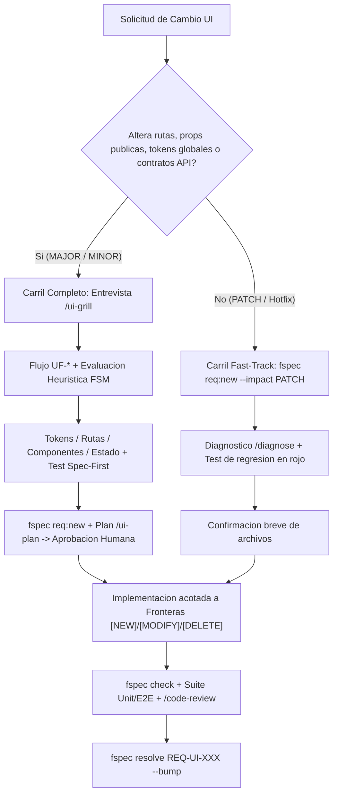

# Guía 03: Flujo de Trabajo Diario (Dos Velocidades y Multi-Harness)

Una vez inicializado el repositorio (Greenfield o Brownfield), todo cambio de código fuente se gobierna bajo el **Protocolo Conversacional Gatekeeper de Dos Velocidades**, respaldado automáticamente por `fspec check --staged`.

> **Regla de Oro:** Prohibido modificar código fuente (`src/`, `app/`, `pages/`, `components/`) sin un requerimiento `REQ-UI-*` activo en `docs/backlog/pending.md` aprobado explícitamente por el usuario. `docs/backlog/audit-proposals.md` es un buzón de solo lectura salvo promoción explícita con `--from-audit`.

---

## Árbol de Decisión de Dos Velocidades



---

## 1. Carril Completo (`MAJOR` / `MINOR`)

Aplica para nuevas vistas, rutas, componentes complejos, cambios en el sistema de diseño o cambios de contrato frontend-backend:

1. **Entrevista Preventiva (`/ui-grill` o `/grill-me`):** El agente consulta los índices `docs/functional/index.md`, `docs/design/index.md` y `docs/technical/index.md` (y `graphify-out/` si existe) aplicando *Código y Tokens primero, humano después*. Solo pregunta decisiones de diseño o UX aún abiertas (estados `Loading`/`Empty`/`Error`, máquina de estados, guardias RBAC, responsive, foco).
2. **Flujo UX (`UF-*`) y Matriz FSM:** Crea o actualiza `docs/functional/user-flows/UF-[DOMINIO]-[NUM]-[slug].md` usando `.spec/templates/_template_user_flow.md` y evalúa la Matriz Heurística FSM de `.spec/templates/ui-contracts-guidelines.md`.
3. **Diseño e Ingeniería Selectiva:** Actualiza únicamente los documentos impactados:
   - `docs/design/tokens-and-themes.md` (paleta claro/oscuro simétrica, contraste WCAG, mapeo CSS/Tailwind).
   - `docs/technical/component-hierarchy.md` (árbol atómico `CMP-*`, `Props`/Slots y FSM `stateDiagram-v2`).
   - `docs/technical/routing-and-rendering.md` (rutas, guardias RBAC, Error Boundaries, CSR/SSR/SSG).
   - `docs/technical/data-fetching-and-state.md` (estado servidor/URL, mapeo RFC 7807, `Idempotency-Key`, handlers MSW).
   - Sidecars opcionales `.spec/specs/*.json` validados contra `schemas/` si el proyecto utiliza validación estructurada JSON.
4. **Registro en Backlog y Test *Spec-First*:** Registra el requerimiento vinculando el flujo funcional:
   ```bash
   fspec req:new "Tabla de analitica con exportacion CSV" --domain DASH --impact MINOR --uf docs/functional/user-flows/UF-DASH-001-analytics-datatable.md
   ```
   El agente prepara el plan de fronteras exactas (`[NEW]`, `[MODIFY]`, `[DELETE]`) y los tests iniciales (Vitest/Testing Library + `axe-core`, y Playwright E2E si el flujo es crítico). **La ejecución se detiene hasta tu aprobación (`/ui-plan` o `/plan`).**
5. **Implementación, Verificación y Cierre:** Tras implementar únicamente los archivos declarados y aprobar pruebas unitarias, a11y, E2E y `/code-review`:
   ```bash
   fspec sync
   fspec check
   fspec resolve REQ-UI-DASH-001 --bump
   ```

---

## 2. Carril Fast-Track (`PATCH` / Hotfix)

Aplica cuando corriges estilos usando tokens existentes, bugs de estado local o ajustes menores de accesibilidad sin alterar rutas públicas, props compartidas ni contratos de API:

1. Omite crear flujos `UF-*` nuevos. Registra un Micro-Spec compacto directamente en modo Fast-Track:
   ```bash
   fspec req:new "Corrige foco visible en selector de rango" --domain DASH --impact PATCH
   ```
   *(El CLI asigna automáticamente `Referencia Funcional: N/A (PATCH / Fast-Track)`).*
2. El agente aplica `/diagnose` (reproduce, aísla, formula hipótesis), escribe el test de regresión en rojo y solicita confirmación breve indicando los archivos exactos a modificar.
3. Tras verificar el fix en verde:
   ```bash
   fspec check
   fspec resolve REQ-UI-DASH-002 --bump
   ```

---

## 3. Equivalencia de Comandos por Harness

`frontend-spec` adapta los disparadores conversacionales a la interfaz nativa de cada herramienta:

| Harness | Archivo de Regla Instalado | Comandos / Workflows UI | Estrategia de Entrevista Interactiva |
| :--- | :--- | :--- | :--- |
| **Antigravity** | `.gemini/rules/frontend-spec.md` | Slash nativos: `/grill-me`, `/plan`, `/boost`, `/goal`, `/diagnose`, `/code-review`, `/compact` | `/grill-me` interactivo nativo |
| **Claude Code** | `CLAUDE.md` (bloque gestionado) | `/ui-bootstrap`, `/ui-grill`, `/ui-plan`, `/ui-resolve` (`.claude/commands/`) | Herramienta `AskUserQuestion` (2-4 decisiones, `(Recommended)` primero) |
| **Cursor** | `.cursor/rules/frontend-spec.mdc` | `/ui-bootstrap`, `/ui-grill`, `/ui-plan` (`.cursor/commands/`) | Herramienta `AskQuestion` por tarjeta interactiva |
| **Windsurf** | `.windsurfrules` (bloque gestionado) | `/ui-bootstrap`, `/ui-grill`, `/ui-plan`, `/ui-execute` (`.windsurf/workflows/`) | Pausa estructurada en chat (`A) (Recomendado) / B) / C)`) |

---

## Siguiente Paso

- Consulta todos los flags del CLI, estructura de archivos y contratos congelados en [Guía 04: Referencia de CLI, Harnesses, Estructura y Contratos](04-cli-harnesses-and-contracts.md).
- Vuelve al índice principal en [README.md](../README.md).
