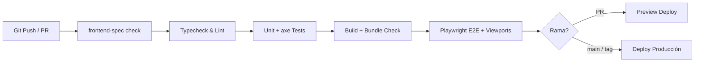

# Estrategia de Build, Despliegue y CI/CD Frontend — {{PROJECT_NAME}}

## 1. Pipeline CI/CD (Mermaid)

---

## 2. Variables Públicas, Caché y Cabeceras
- **Variables de Entorno:** Exclusivamente variables públicas con prefijo del bundler (`VITE_*`, `NEXT_PUBLIC_*`, `NUXT_PUBLIC_*`, `PUBLIC_*`). Cero secretos en código cliente.
- **Caché:** `Cache-Control: public, max-age=31536000, immutable` para assets con hash; `no-cache, must-revalidate` para HTML de entrada.
- **Cabeceras de Seguridad:** `Content-Security-Policy`, `X-Content-Type-Options: nosniff`, `Referrer-Policy: strict-origin-when-cross-origin`, `X-Frame-Options: DENY`.
- **Rollback:** Reversión atómica inmediata si aparecen `ChunkLoadError` o degradación de Web Vitals en producción.

---

## Historial de Revisiones (Últimos Cambios)

| Versión | Fecha | Requerimiento | Resumen del Cambio |
| :--- | :--- | :--- | :--- |
| `v{{CURRENT_VERSION}}` | {{TODAY}} | `INIT` | Pipeline CI/CD base, caché inmutable y reglas de variables públicas. |

> *Nota: Esta tabla mantiene una ventana deslizante de los últimos 3 cambios. Para el historial completo, consultar [`docs/backlog/changelog.md`](../backlog/changelog.md).*
