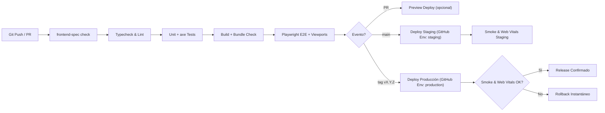

# Estrategia de Build, Despliegue y CI/CD Frontend — {{PROJECT_NAME}}

## 1. Pipeline CI/CD (Mermaid)

> **Convención de Ramas y Adaptación:** Flujo estándar `PR -> CI (+ Preview opcional)`, `main -> Staging`, `tag vX.Y.Z -> Producción`. En plataformas PaaS (Vercel, Netlify, Cloudflare Pages) adapta la rama de staging/preview según el proveedor; en monorepos usa filtros `paths:` y tags prefijados (`web-vX.Y.Z`).

---

## 2. Variables Públicas por Ambiente, Caché y Cabeceras

| Variable | Prefijo | Propósito | Tipo CI/CD | Ambientes |
| :--- | :--- | :--- | :--- | :--- |
| `*_API_BASE_URL` | `VITE_` / `NEXT_PUBLIC_` / `PUBLIC_` | URL pública del API gateway | `var` (`vars.*`) | `local`, `preview`, `staging`, `production` |
| `*_APP_ENV` | `VITE_` / `NEXT_PUBLIC_` / `PUBLIC_` | Entorno (`development` / `staging` / `production`) | `var` (`vars.*`) | `local`, `preview`, `staging`, `production` |

- **Regla de Seguridad y `.env.example`:** Exclusivamente variables públicas con prefijo del bundler (`VITE_*`, `NEXT_PUBLIC_*`, `NUXT_PUBLIC_*`, `PUBLIC_*`). Cero secretos en código cliente ni archivos `.env.staging`/`.env.production` con credenciales en Git; mantén `.env.example` sincronizado, usa `secrets.*` solo para tokens del proveedor CI de despliegue y audita con `gh variable list --env <env>` / `gh secret list --env <env>`.
- **Caché:** `Cache-Control: public, max-age=31536000, immutable` para assets con hash; `no-cache, must-revalidate` para HTML de entrada.
- **Cabeceras de Seguridad:** `Content-Security-Policy`, `X-Content-Type-Options: nosniff`, `Referrer-Policy: strict-origin-when-cross-origin`, `X-Frame-Options: DENY`.
- **Rollback:** Reversión atómica inmediata si aparecen `ChunkLoadError` o degradación de Web Vitals en producción.

---

## Historial de Revisiones (Últimos Cambios)

| Versión | Fecha | Requerimiento | Resumen del Cambio |
| :--- | :--- | :--- | :--- |
| `v{{CURRENT_VERSION}}` | {{TODAY}} | `INIT` | Pipeline CI/CD base, caché inmutable y reglas de variables públicas. |

> *Nota: Esta tabla mantiene una ventana deslizante de los últimos 3 cambios. Para el historial completo, consultar [`docs/backlog/changelog.md`](../backlog/changelog.md).*
