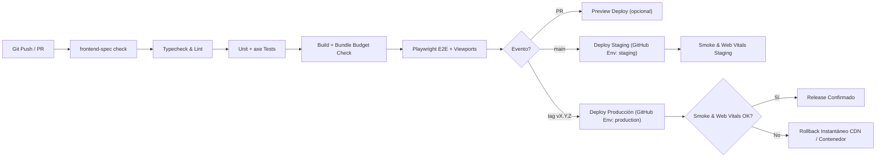

# Blueprint: Estrategia de Build, Despliegue y CI/CD Frontend

## 1. Pipeline CI/CD Estándar (Mermaid)

> **Convención de Ramas y Excepciones:** Estándar `PR -> CI (+ Preview)`, `main -> Staging` (`fspec resolve <REQ-UI-ID>`) y `tag vX.Y.Z -> Producción` (`fspec resolve <REQ-UI-ID> --bump` + tag anotado). En PaaS (Vercel/Netlify/Cloudflare Pages) documenta el comportamiento nativo de previews; en monorepos usa filtros `paths:` y tags prefijados (`web-vX.Y.Z`).

---

## 2. Variables de Entorno Públicas por Ambiente (Sin Secretos)

| Variable | Prefijo del Stack | Descripción | Tipo CI/CD | Ambientes |
| :--- | :--- | :--- | :--- | :--- |
| `*_API_BASE_URL` | `VITE_` / `NEXT_PUBLIC_` / `PUBLIC_` | URL pública del API gateway | `var` (`vars.*`) | `local`, `preview`, `staging`, `production` |
| `*_APP_ENV` | `VITE_` / `NEXT_PUBLIC_` / `PUBLIC_` | Entorno (`development` / `staging` / `production`) | `var` (`vars.*`) | `local`, `preview`, `staging`, `production` |

> **Regla de Seguridad Crítica y Contrato `.env.example`:** Cualquier variable empaquetada en cliente es pública por definición. Nunca colocar claves privadas API, secrets OAuth ni llaves de firma en variables de build del frontend, ni versionar `.env.staging`/`.env.production` con secretos. Sincroniza toda nueva variable en esta tabla, en `.env.example` y en `.github/workflows/*.yml` (`vars.*` para variables públicas; `secrets.*` solo para tokens del proveedor de deploy), y audita antes de liberar con `gh variable list --env <env>` y `gh secret list --env <env>`.

---

## 3. Cabeceras de Seguridad, Caché y Rollout
- **Caché Inmutable:** Assets con hash (`/assets/*`, `/_next/static/*`) servidos con `Cache-Control: public, max-age=31536000, immutable`; documento raíz (`index.html`) con `Cache-Control: no-cache, must-revalidate` para evitar clientes atrapados en versiones obsoletas tras un despliegue.
- **Cabeceras de Seguridad HTTP:** `Content-Security-Policy`, `X-Content-Type-Options: nosniff`, `Referrer-Policy: strict-origin-when-cross-origin`, `X-Frame-Options: DENY` (o `frame-ancestors`).
- **Estrategia de Rollout / Rollback:** Despliegue atómico (CDN o Rolling/Blue-Green en SSR) con rollback inmediato si aumentan errores 5xx/chunks faltantes (`ChunkLoadError`) o degradan Web Vitals en el primer tramo de tráfico.

---

## Historial de Revisiones (Últimos Cambios)

| Versión | Fecha | Requerimiento | Resumen del Cambio |
| :--- | :--- | :--- | :--- |
| `v0.1.0` | YYYY-MM-DD | `INIT` | Plantilla base de despliegue, caché, seguridad y CI/CD frontend. |

> *Nota: Esta tabla mantiene una ventana deslizante de los últimos 3 cambios. Para el historial completo, consultar `docs/backlog/changelog.md`.*
